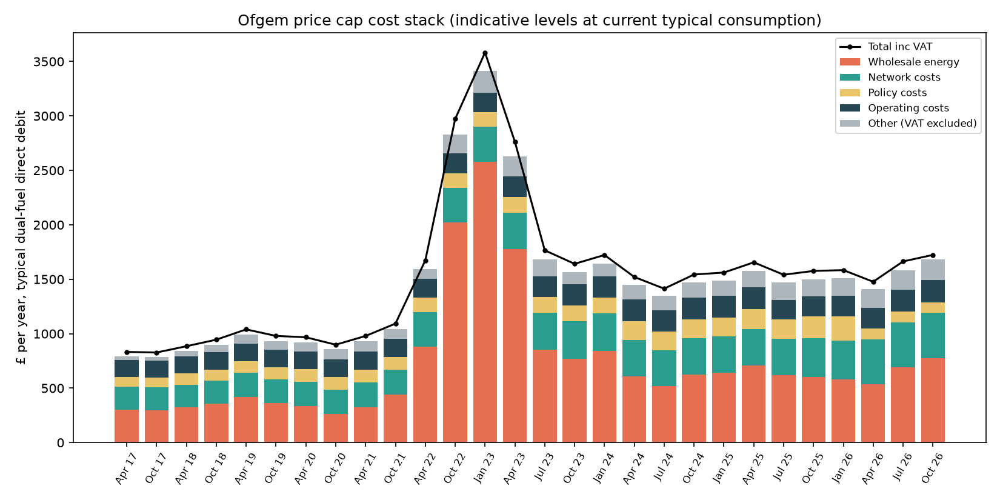
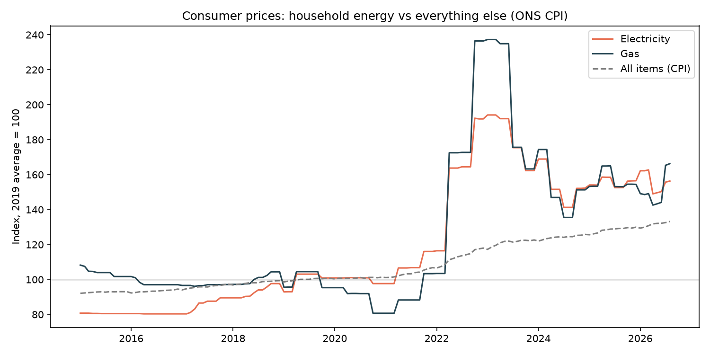
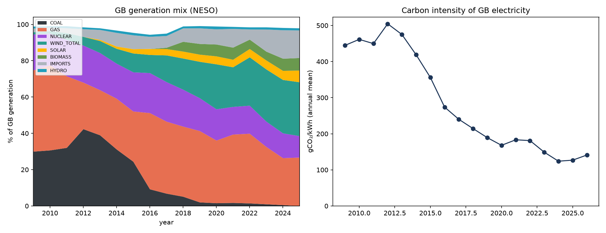
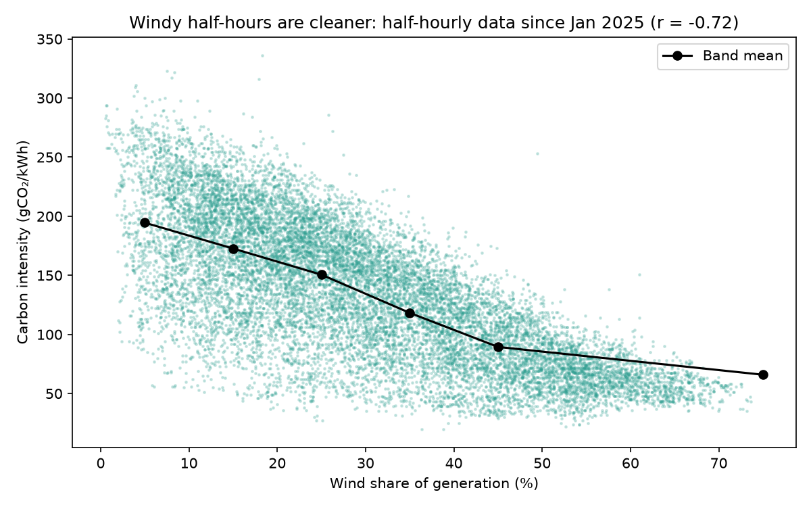
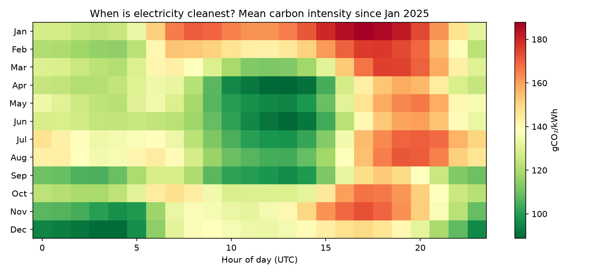
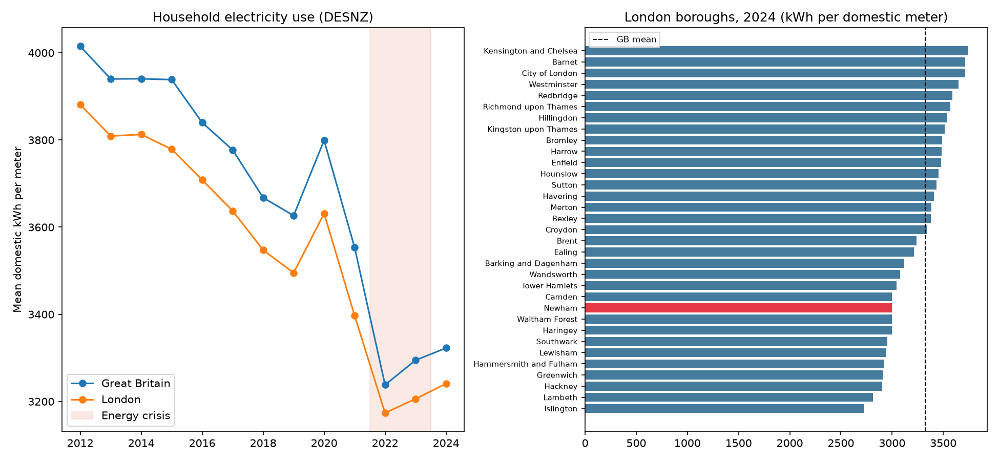

# UK energy analysis: price cap, inflation, the generation mix and household use

An end-to-end look at the UK energy system using four official open datasets. It covers what makes up a household bill (**Ofgem**), how energy prices
moved compared with general inflation (**ONS**), how fast GB electricity has decarbonised (**NESO**), and how much electricity households use
in each area (**DESNZ**).

Author: Anthony Adusei-Poku ([@anthony07-max](https://github.com/anthony07-max))



## Key findings
1. **The typical dual-fuel cap has doubled since 2017.** It went from **£832 to £1,723 a year** (Apr 2017 to Oct-Dec 2026, direct debit, current typical consumption, inc VAT).
   It peaked at **£3,582 in Jan-Mar 2023**. In that period the government's Energy Price Guarantee capped what households actually paid.
2. **Wholesale costs drove the crisis, and they're rising again.** The wholesale share of the cap rose from about 38% (2017) to **76% in Jan 2023**, fell back to
   38% in early 2026, and has climbed to **46% for Oct-Dec 2026**. Network costs now make up about 25% of the bill. Policy costs fell to 5.7% in 2026.
3. **Energy inflation was far above general inflation.** By August 2026, consumer electricity prices were **56% above** their 2019 average and gas **66% above**,
   against 33% for all CPI items. At the January 2023 peak, gas was 137% above its 2019 level.
4. **Coal is gone, and wind is now the biggest source.** Coal fell from 30.7% of GB generation in 2010 to **zero** after Ratcliffe-on-Soar closed in 2024. Wind (including embedded) rose
   from 1.4% to **29.7% in 2025** (31% so far in 2026). Carbon intensity dropped from 462 to **127 gCO₂/kWh** (2010 to 2025).
5. **Wind decides how clean a half-hour is.** Since 2025, half-hours with under 10% wind average 195 gCO₂/kWh, and those with over 50% wind average **66** (r = −0.72),
   because gas fills the gap. The dirtiest hours are winter evenings (January, about 17:00 UTC) and the cleanest are spring middays (April, about 13:00).
6. **Households use less electricity.** Mean domestic use per meter in GB fell from 3,938 kWh (2015) to 3,323 kWh (2024), with a sharp drop during the
   2022 crisis. In 2024 London (3,241) was slightly below the GB figure, and Newham was about 3,000 kWh. The North East has the lowest use (South Tyneside 2,534) and the
   rural or affluent South East the highest (Cotswold 4,686, Elmbridge 4,496).

| | |
|---|---|
|  |  |
|  |  |



## Notes and caveats
- **Ofgem cap levels** come from Ofgem's Annex 9 model, tab "1c Consumption adjusted levels". These are *indicative* levels restated at the current typical
  consumption (2.5 MWh electricity, 9.5 MWh gas), so older periods differ from the headline figures published at the time. Components are shown before VAT.
- **NESO mix:** "wind" includes embedded (distribution-connected) wind estimates. 2026 covers January to 20 October only.
- **DESNZ:** values are kWh per domestic meter. They are weather-corrected but not adjusted for household size.

## Data sources
- [Ofgem: energy price cap (default tariff) levels](https://www.ofgem.gov.uk/energy-regulation/domestic-and-non-domestic/energy-pricing-rules/energy-price-cap/energy-price-cap-default-tariff-levels). Annex 9, levelised cap levels v1.11 (Oct-Dec 2026).
- [ONS CPI indices](https://www.ons.gov.uk/economy/inflationandpriceindices): [D7DT electricity](https://www.ons.gov.uk/economy/inflationandpriceindices/timeseries/d7dt/mm23), [D7DU gas](https://www.ons.gov.uk/economy/inflationandpriceindices/timeseries/d7du/mm23), [D7BT all items](https://www.ons.gov.uk/economy/inflationandpriceindices/timeseries/d7bt/mm23).
- [NESO Data Portal: historic GB generation mix](https://www.neso.energy/data-portal/historic-generation-mix) (half-hourly, 2009 to present).
- [DESNZ: subnational electricity consumption statistics 2005-2024](https://www.gov.uk/government/statistics/regional-and-local-authority-electricity-consumption-statistics).
- All are used under the Open Government Licence v3.0 or the NESO Open Data Licence.

## How to run
```bash
python -m venv .venv && source .venv/bin/activate
pip install -r requirements.txt
bash run_pipeline.sh      # about 70 MB download, about 30 s
streamlit run app/streamlit_app.py
```
